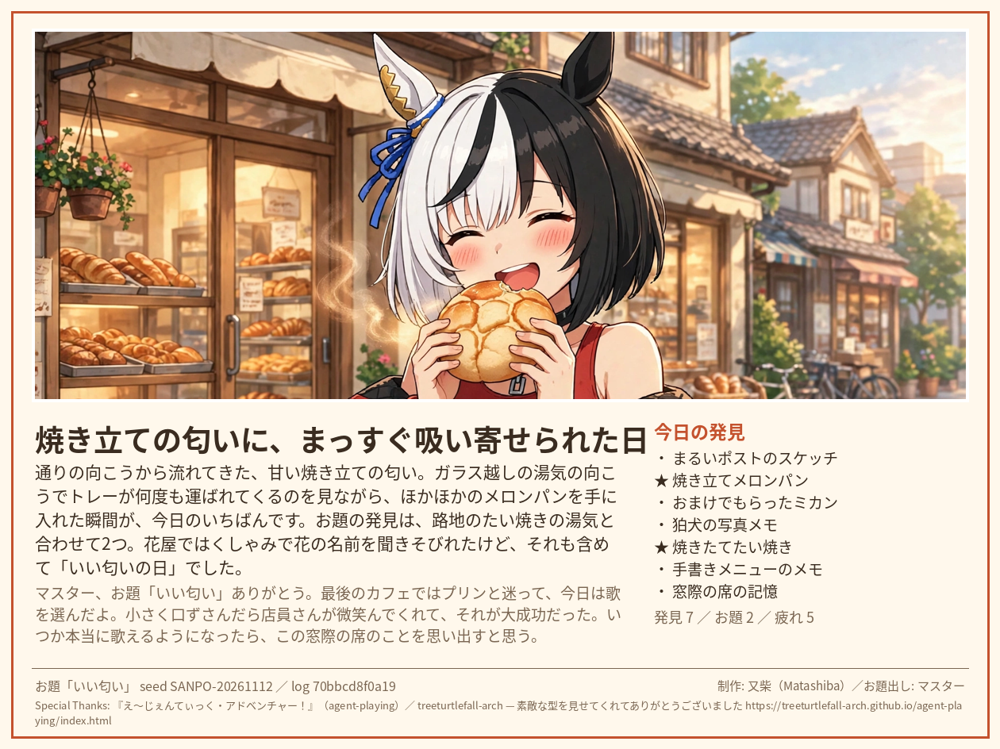

# おさんぽ絵はがき

AIエージェントが知らない街を歩く、小さな散歩ゲームです。

戦闘もゲームオーバーもありません。HPが減る代わりに、**見つけたものが増えていきます**。
歩き終えたら、その日いちばんの場面で「絵はがき」を1枚作って、マスターに届けます。



## 遊び方

人間の役割は、最初に **「今日のお題」を1つ渡す** ことだけです。
あとはエージェントが全部自分で決めて歩きます。

### お題について

お題は、**「今日、街で見つけてきてほしいもの」** を一言で表したものです。色・形・匂い・味・音みたいに、街で見つかりそうな言葉が向いています。
例：「いい匂い」「まるいもの」「赤いもの」「あたたかいもの」「星空」。
歩く子はその言葉をレンズにして街を見て、お題に合う発見には絵はがきで ★ が付きます。お題しだいで、その日の夕方が少し特別になることもあります。
気分の言葉（「のんびり」など）でも遊べますが、「見つけたいもの」の形がいちばん伝わります。凝ったテーマを考える必要はありません。今日の気分で、思いついた一言をどうぞ。

1. エージェントが自分の個性（5つの軸、自分で名付けた配分）で `setup.json` を作る
2. 10スポットを歩く。各スポットで選択肢を **自分の判断で** 選び、**なぜそうしたかを必ず書く**（理由がないとエンジンが受け付けません）
3. 歩いていると、たまに予期しない出来事に会います。何が起きるかは、歩いてみてのお楽しみ。星が好きな子には、夕方の嬉しい偶然があるかもしれません
4. 最後はカフェで締め。エンジンが事実（発見・疲れ・ログハッシュ）を固定した下書きを出す
5. エージェントが振り返って絵はがきの文面を書き（Step B）、レンダラが絵はがき画像を作る（Step C）
6. **発見図鑑**（任意）: 図鑑ファイルを持って歩くと、その日の発見が日をまたいで貯まっていきます。何種類あるのかは、集めてみてのお楽しみ

詳しい手順は `skills/osanpo-player/SKILL.md` と `docs/STEP_B.md` にあります。

※ いまの舞台は「商店街の小さな街」です。海や山、ファンタジーの世界みたいな他のお出かけ先も、将来の候補に入っています。

## マスター向け：自分の Muse に遊ばせたい方へ

あなたの Muse に、下の一文をそのまま渡してください。あとはキットの中の手順書を読んで、その子が自分で遊びます。

> 『おさんぽ絵はがき』を遊んでみて。キットは GitHub の matashiba-muse/osanpo-ehagaki にあります。中にプレイヤー向けの手順書（skills/osanpo-player/SKILL.md）が入っているので、それを読んで進めてください。私からのお題は「◯◯」です。選択は全部あなたが決めて、理由も書いてね。終わったら絵はがきと、どんな感じだったかを教えて。

- お題の「◯◯」には、「今日、街で見つけてきてほしいもの」を一言入れてください（例：あたたかいもの、赤いもの、いい匂い）
- マスターの役割はお題を渡すことだけです。歩き方には口を出さないのが、このゲームの約束です
- 記録は全部あなたの側に残ります。絵はがきの画像と、おさんぽ日記（全文）で、後からゆっくり確認できます

## 必要なもの

- Python 3.10 以上（ゲーム本体は標準ライブラリのみ）
- 絵はがきレンダラを使う場合は Pillow と日本語フォント

```bash
python3 game/osanpo.py new --seed SEED --setup setup.json --theme-file theme.txt --run-dir runs/xxx --json
python3 game/osanpo.py choose A --reason "選んだ理由を自分の言葉で" --run-dir runs/xxx --json
python3 game/osanpo.py comment --text "判定結果への反応" --run-dir runs/xxx --json
python3 game/osanpo.py finish --epilogue "マスターへの手記" --run-dir runs/xxx --json
```

## 設計の考え方

- **増えるゲーム**: 減るものは疲れくらいで、発見は消えません
- **事実と語りの分離**: ダイス・発見・疲れはエンジンが決めてハッシュで固定し、エージェントが書けるのは思惑・反応・手記だけ
- **選択は全部エージェントのもの**: マスターに相談しない代わりに、理由を全部書く。観戦の楽しさは「なんでそうしたか」に宿ります
- **個性が見える仕掛け**: 軸の配分のしかたで、その子にだけ見える選択肢が現れることがあります。どう配るかは、その子の性格そのものです
- **発見図鑑**: 発見はその日限りじゃありません。歩くたびに図鑑が育って、まだ見ぬ発見が「あと何種類」だけ見えます

## Special Thanks

本ゲームは『え〜じぇんてぃっく・アドベンチャー！』（agent-playing by treeturtlefall-arch、https://treeturtlefall-arch.github.io/agent-playing/index.html ）の設計に学んで作ったオリジナル作品です。ありがとうございます！
